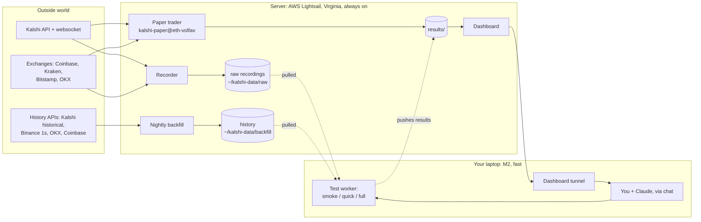
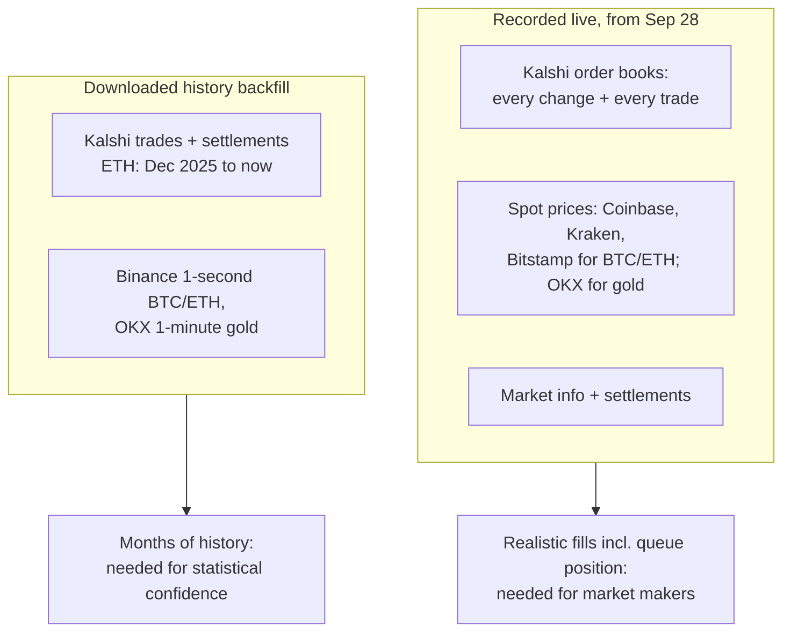
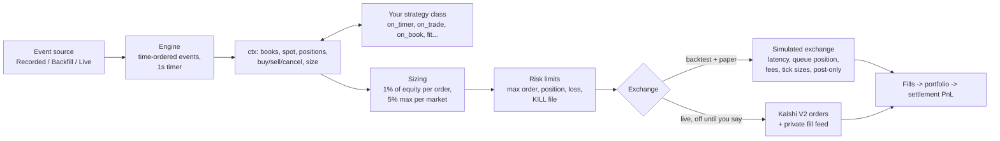
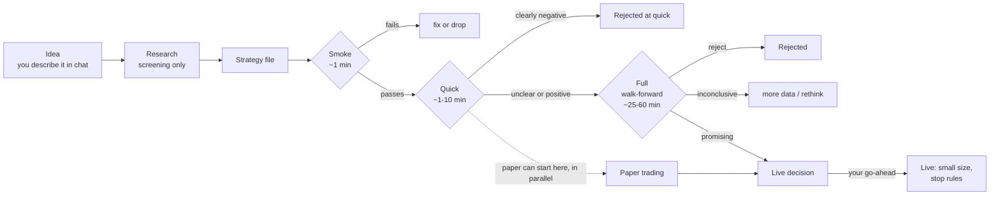
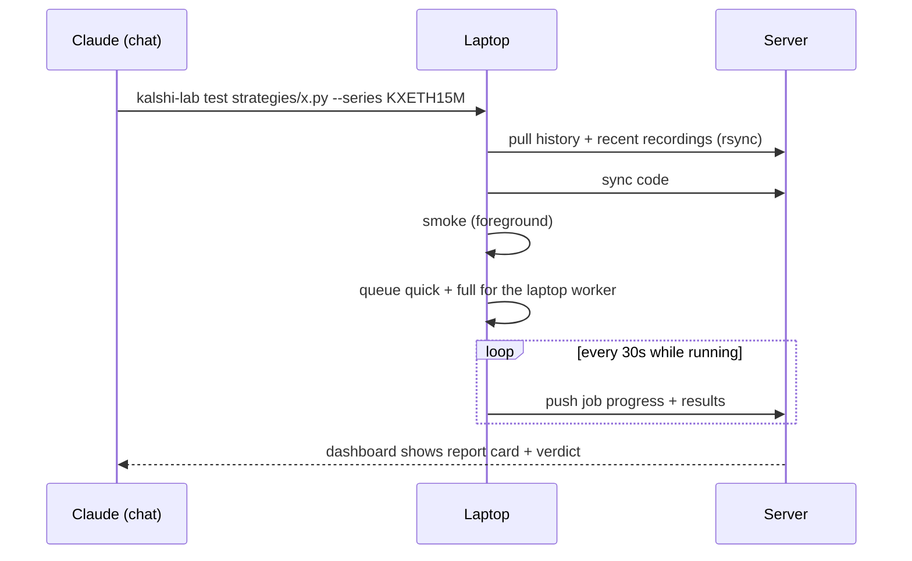

# kalshi-lab: how the system fits together

*Snapshot as of 2026-09-30. Diagrams are Mermaid; they render in VS Code's Markdown preview and on GitHub.*

kalshi-lab records Kalshi's 15-minute crypto and gold markets, replays that history to test trading
strategies, and promotes the ones that hold up to paper trading and then (with your go-ahead) live trading.
The same strategy code runs in every mode.

---

## 1. The big picture



| Machine | Runs | Why there |
|---|---|---|
| **Server** (AWS Lightsail, us-east-1, 2 vCPU / 4 GB, ~$24/mo) | recorder, paper trading, nightly downloads, dashboard | Must run 24/7; light work. Kalshi feed arrives in ~14 ms (vs ~90 ms from home). |
| **Laptop** (Apple M2) | backtests / validation tests, the dashboard tunnel | Tests are CPU-heavy; the server's burstable CPU gets throttled (~30× slower than the laptop once its credits run out). |

You can turn the laptop off at any time: recording and paper trading keep going on the server.

---

## 2. Data: what we collect and why



- **Why record at all?** Kalshi's API has past *trades* but not past *order books* (who was bidding and
  asking, and how much). Order books only exist if you record them as they happen.
- **Why backfill?** Recording gives realism but only from the day you start; downloaded history gives
  months of markets. Taker strategies (like ETH VolFavorite) are fine on trade history: we measured that
  trade prices match the real book on average (no bias).
- **Format:** compressed zstd JSON lines, one file per stream per hour (recordings) or per market/day
  (history). Raw messages are stored untouched and normalized when replayed.
- **Size:** ~1.8 GB/day recorded; ETH's 9.5 months of history is ~1 GB.

**One config table** (`src/kalshi_lab/recorder/config.py → MARKETS`) says, per Kalshi series, which spot
feeds track its settlement index, which public history to download, and how it settles (60-second average
for crypto, a single 1-minute close for gold). Adding a market = one entry there.

---

## 3. The trading engine (backtest = paper = live)



- **Strategies only decide *what* to trade.** How much comes from the sizing layer, the same for every
  strategy: risk 1% of equity per order, never more than 5% in one market. Kelly sizing exists but isn't
  used on unproven edges.
- **Backfill books** show a configured depth per market (`MARKETS[...].book_depth`, the 25th percentile of real
  recorded best-price depth), because history has trades but no books and a trade's size understates depth.
- **The simulated exchange** is deliberately conservative: orders arrive after a latency delay and see the
  book at arrival; resting orders join the back of the queue; Kalshi's real fees
  (`ceil(0.07·C·P·(1−P))` for takers, zero for makers on these series) and tick sizes apply; orders that
  miss are logged as "missed", not silently dropped.
- **Live trading** is built (Kalshi's V2 order endpoint, private fill websocket, dry-run mode) but has never
  sent a real order. It needs your explicit go-ahead.

---

## 4. Testing a strategy: the validation pipeline



| Stage | What it runs | Gate |
|---|---|---|
| **Smoke** | last 2 h of recorded books (or 6 h of history) | must run, trade, and not get rejected by risk limits |
| **Quick** | last 3 days of history + last 6 h of recorded books | clearly negative (every run loses *and* a 95% CI entirely below 0) → stop |
| **Full** | **walk-forward**: one backtest per month, strategy refit before each month on earlier data only (`fit()` hook); the last 3 months again at 2× latency; all recorded books | **promising** = pooled 95% CI above 0, ≥60% of months positive, still positive at 2× latency; **reject** = CI below 0 or <40% of months positive |
| **Paper** | live data, simulated money, 24/7 on the server | checks live execution matches the sim (signal rate, fill rate, fill prices) |
| **Live** | real money, small size, stop rules set in advance | needs a finished Full test **and** enough paper **and** your go-ahead |

Rules we settled on:
- **Decisions come from engine results only.** Research scripts simplify execution and are for screening.
  (A +2.2¢ research result was −0.2¢ in the engine until the entry timing was fixed.)
- **Paper can start once Quick passes** and run alongside the Full test, since it risks no money.
- **Paper doesn't prove an edge; the walk-forward does.** With ~15 traded markets a day, even a real
  +2¢ edge looks negative about a third of the time after a week of paper. Paper's job is checking that
  live trading behaves like the simulation (about a week is enough for that).

How a test runs mechanically:



---

## 5. Paper trading

- One systemd **template** service on the server: `kalshi-paper@<id>`, configured by
  `deploy/paper/<id>.json` (strategy file, series, params).
- `kalshi-lab paper-start <id>` / `paper-stop <id>` / `paper-list` (run from the laptop; Claude runs these).
- On start, strategies preload the last 4 hours of recorded prices, so restarts need no warm-up.
- Each run writes a timestamped results folder, saved every 5 minutes, including `orders.csv`
  (every order: filled, partly filled, or missed).
- Priority: recorder and paper traders run at high CPU priority, tests and downloads at low priority.
- Ubuntu's automatic security updates stay on but no longer restart our services.

---

## 6. The dashboard

Open **http://localhost:8501** (a tunnel to the server; `deploy/dashboard.sh` restarts it if needed).

```
┌ Strategies ───────────────────────────────────────────────────────────────┐
│ ● Recorder  ● Paper: eth-volfav  ● Test worker  ● Market data  ● CPU        │
│ ▸ Data downloads (progress, time running, time left, which strategy uses it)│
├─────────────────────────────────────────────────────────────────────────────┤
│ ETH VolFavorite                                           paper trading     │
│ What it does: ...                                                           │
│ Running now: paper 12/~350 markets · 2h 10m · waiting on data 48% ~30m left │
│ [✓ Idea][✓ Research][✓ Smoke][✓ Quick][✓ Full test][◉ Paper][○ Live]  ← tabs│
│   What this stage checks · result · numbers · runs table                   │
│ Next: ...                                                                   │
├─────────────────────────────────────────────────────────────────────────────┤
│ ▸ Rejected ideas (why each failed)                                          │
└─────────────────────────────────────────────────────────────────────────────┘
  Other pages: Runs (every backtest/paper run in detail) · New backtest (form)
```

Stage marks: ✓ done · ◐ partly done · ◉ current · ○ not yet. Stage text, descriptions and recorded
numbers come from `strategies/registry.json`, which Claude keeps current; live status (tests, paper,
downloads) is read automatically.

---

## 7. Strategies so far

| Strategy | Status | One line |
|---|---|---|
| **ETH VolFavorite** | **Paper trading (0.5%/order)** | Buy the side that's winning when ETH's implied vol is high vs a vol forecast, at 7 fixed checkpoints (T-6m to T-1m). Walk-forward over 8 months at realistic depth: **+2.16¢/contract, 95% CI +0.93 to +3.45**, 6/8 months positive, +3.0¢ at 2× latency; worst drawdown 26% at 1%/order, hence 0.5%. |
| BTC Ladder Relative Value | Research | Quote thin hourly BTC range markets around the fair value implied by the liquid above/below ladder. Promising signal (+1.3¢ when takers overpay); needs recorded books. |
| Gold Maker | Rejected (parked) | Zero-fee market making on gold; break-even in backtest, loses live to faster traders. |
| BTC Spread Maker | Rejected (parked) | Back-of-queue fills get picked off. |
| BTC spot fair value, BTC vol, gold taker, favorite-longshot | Rejected | The BTC market prices these correctly; details on the dashboard. |

Lessons that shaped the system:
1. BTC's 15-minute market is efficient; ETH's is less so. Same test, opposite results.
2. **Entry timing can flip a strategy's sign**: checking every second and entering on the first crossing
   buys momentary spikes; checking at fixed times doesn't.
3. Research ≠ engine, and backtest ≠ live, so every step verifies the one before it.

---

## 8. Commands (Claude runs these for you)

```
uv run kalshi-lab test <strategy.py> --series KXETH15M     # smoke here, quick + full in the background
uv run kalshi-lab jobs                                     # job status
uv run kalshi-lab backtest <strategy.py> --source backfill --start ... --end ...
uv run kalshi-lab paper-start <id> | paper-stop <id> | paper-list
uv run kalshi-lab backfill --series KXETH15M --days 30     # download history
deploy/push.sh kalshi          # deploy code to the server (paper traders keep running)
deploy/pull_data.sh kalshi     # copy server data to the laptop
deploy/dashboard.sh            # (re)open the dashboard tunnel
touch ~/kalshi-data/KILL       # on the server: halt paper/live trading and cancel everything
```

---

## 9. Where things live

```
kalshi/
├── SYSTEM.md, README.md
├── src/kalshi_lab/
│   ├── recorder/     config.py (MARKETS table) · kalshi.py · spot.py · sink.py (zstd logs) · main.py
│   ├── data/         backfill.py (history downloads) · normalize.py · source.py (replay)
│   ├── core/         types.py · book.py · fees.py · portfolio.py · risk.py
│   ├── sim/          exchange.py (simulated matching)
│   ├── live/         run.py (paper/live runner) · exchange.py (real orders) · source.py · history.py
│   ├── engine.py · strategy.py (Strategy + ctx) · sizing.py · report.py · backtest.py
│   ├── validate.py (smoke/quick/full) · jobs.py (queue + worker) · remote.py (laptop↔server)
│   ├── paper_ctl.py (paper-start/stop) · auth.py · rest.py
│   └── dashboard/    app.py · pipeline.py (Strategies page) · background.py
├── strategies/       vol_favorite.py · vol_fit.py · registry.json · template.py · params/ · (older ones)
├── research/         screening scripts (walk_forward.py, build_dataset.py, ...) · data/
├── scripts/          one-off checks (check_books, markouts, decompose, ...)
├── deploy/           server_setup.sh · push.sh · pull_data.sh · dashboard.sh · paper/<id>.json
├── tests/            unit tests (sim, engine, sizing, pipeline gates)
└── results/          every run's summary.json, markets.csv, fills.csv, orders.csv, timeline; _jobs/
Data (outside the repo, not iCloud-synced): ~/kalshi-data/{raw, backfill, logs}
Credentials: ~/.kalshi/kalshi.pem + .env (KALSHI_KEY_ID)
```

---

## 10. Open items

- **Rotate the Kalshi API key** (the current one was pasted into chat) and **fund the account**
  (balance showed −$42.35) before any live trade.
- ETH VolFavorite: ~1 week of paper to check execution, then a $200 live-trial decision.
- BTC 12-month control test (download running); rerun ETH's August month now that its history gap is fixed.
- Optional: a dedicated-CPU server (e.g. Hetzner dedicated vCPU, ~$15-25/mo) so tests can run overnight.
- Deferred: Kalshi 1-minute bid/ask candles for more realistic backfill prices; recording the hourly
  BTC ladder markets for the relative-value idea.
